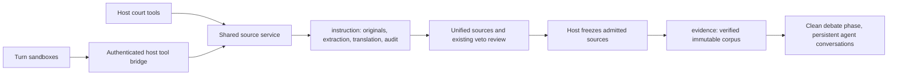

# Shared instruction, settled evidence

> Completion scope updated by the user on 2026-11-05: finish and commit the implementation without the staging smoke, and support normal production deployment via a push. New cases default to shared instruction without a staging-only guard; persisted cases keep their recorded version and `COURT_PIPELINE_VERSION=1` remains a rollback for new cases. Deployed smoke, OIDC/egress verification, and real provider cache/cost measurements are deferred, not passed. This local work does not push, deploy, create paid resources, or write production data.

Each source will be downloaded, extracted, and translated by one shared service, not separately by each assistant. Closing instruction will produce an immutable `evidence/` folder containing admitted material in the case language. Each agent starts debate clean once, then keeps its conversation and sandbox across interventions, using that corpus and the subsequent discussion—not instruction history or the live web.

The production export contains 63 download manifests for 30 exact URLs: 33 repeated manifests beyond one per URL. Keep the turn sandboxes, but make them clients of shared host tools rather than independent source processors.

## What changes

### A host-owned source reader replaces independent processing

Add `src/instruction/sources.ts` and `src/instruction/source-store.ts`, backed by an additive `case_source_operations` table in `src/store.ts`. Expose `read_source` through `src/court/research.ts` and the sandbox tool bridge described below. It owns downloading, extracting/OCR, language handling, and persistence, reusing the existing safe downloader, extractors, and configured translator. Both callers use the same service and durable keys.

```ts
// Available during instruction; repeated calls read the same stored source.
read_source({ url: "https://example.org/report#p3", page: 3, maxChars: 6000 })
// Representative response:
{
  sourceId: "src_a81f",
  status: "ready",
  reused: true,
  language: "es",
  blocks: [{ id: "p3:b2", text: "…stored translation…" }],
  nextPage: 4
}
```

The first request materializes the source; other assistants and retried turns reuse it. Extract to Markdown from the outset, preserving headings, tables, links, and stable page/block identifiers through translation. Responses are bounded and paginated, with explicit continuation/truncation information; full Markdown bodies stay in storage. Analysts still independently evaluate sources, but never translate or reconstruct their contents themselves.

Deduplication has three keys:

- **Acquisition:** case + normalized HTTP(S) URL. Use `URL` normalization and ignore fragments; preserve query strings and path case. Persist verified redirect aliases. Never guess that different URLs are equivalent.
- **Extraction:** raw content hash + extractor/configuration version + relevant context, including the resolved base URL for HTML links. Identical compatible content reuses extraction, including OCR.
- **Translation:** extracted-Markdown hash, including title + target language + translator model/options/prompt version. Persist language decisions and each translation chunk; repeated requests must not repeat even a same-language check. Preserve originals, numbers, Markdown structure/links, anchors, and provenance.

Use Postgres uniqueness and short transactional ownership claims, not a process-local map or Blob existence check. Checkpoint each stage and publish its result only after its artifacts and hashes exist. Concurrent waiters receive the published result or an explicit pending/failure status within the turn deadline; they do not start their own job. Completed stages survive workflow retries. Known failures are shared too, with no automatic retry storm.

**“Once” means one shared logical acquisition and one execution of each completed processing stage.** Redirects and the existing direct-fetch/browser fallback remain one acquisition pipeline. If a worker dies after an external operation but before its checkpoint, mark that stage uncertain rather than silently repeat it. A narrow `scripts/recover-source.ts --case … --operation … --reason …` command records explicit permission to retry; it never runs automatically. Strict exactly-once billing cannot be guaranteed across that crash window. Unknown aliases may still require an initial fetch before equivalence is discovered; provider-internal search crawling is outside this guarantee.

### Participating agents receive only the case language

Translate before exposing material to an analyst or moderator: submission descriptions and claim quotations, source titles/passages, search snippets, X posts, OCR/table text, and source-review inputs. Source and evidence tools have no original-language option. URLs, identifiers, numeric data, and machine-readable keys remain intact; all source prose, quoted passages, and model-facing notices use the resolved case language.

Only host-owned detection/extraction/translation workers may inspect originals. Keep originals and source-language extraction in `instruction/` for human audit, but never upload them to participating agents' sandboxes or serialize them into prompts/tool results. Remove raw-image/foreign-text fallbacks: unavailable translation is a recorded source-processing failure, not permission to ask the analyst to translate. Model-facing projections must exclude fields such as `translation.original`, even when retained in stored events.

Settled `evidence/` contains case-language content and provenance/hashes, not foreign originals. Source criticism uses that same language-normalized material and processing-quality metadata. Arguments and quotations use the canonical case-language passages; normalize any out-of-language court text once before publication/broadcast, keeping its pre-normalization form audit-only.

### Turn sandboxes call the same host tools

Yes: a sandbox can call a host-provided tool over HTTPS, including an HTTP MCP server. The installed SDK already provides `networkPolicy.forwardURL` and `defineSandboxProxy` from `@vercel/sandbox/proxy`, which validates Sandbox OIDC and supplies the source team/project/sandbox identity. Use that native bridge with a small JSON tool protocol first; MCP can wrap the same service later without changing ownership or deduplication.

```http
POST /api/cases/{caseId}/turn-tools
Content-Type: application/json

{"tool":"read_source","input":{"url":"https://example.org/report","page":3}}
```

Add `src/app/api/sandbox/[...path]/route.ts` using `defineSandboxProxy` and register harness `read_source`/`read_evidence` tools. Dispatch its reconstructed original path to the same service host-side court tools call directly. Authorize the verified team/project and bind each sandbox ID to its case, seat, phase session, expiry, and budgets. OIDC authentication alone is not case authorization. Enable turn-specific actions only during that seat's active turn; suspend them between turns and revoke the phase binding on completion/abort. Recheck committed phase on every request: an old instruction sandbox cannot acquire sources after settlement.

Extend `src/evidence/broker.ts` to forward only approved tool paths/methods to a configured trusted HTTPS application origin. Remove `"*": []` and add terminal deny rules for unmatched requests on allowed domains. The SDK's proxy adds/verifies OIDC; no tool bearer token or Blob/database/gateway credential enters the VM. Handle Auth0/deployment protection for this SDK-authenticated route without weakening ordinary application authentication. Verify deployed reachability and OIDC audience/path behavior; fail closed if unavailable. Never accept a proxy origin supplied by the model.

Keep bounded local computation in the sandbox, but not a route around shared processing. Forward its gateway generation requests through the same SDK-authenticated proxy: permit only snapshotted model/options and ordinary generation with harness custom tools; reject provider-native search, URL readers, arbitrary gateway tool calls, and extra endpoints. The host adds the gateway credential after validation. Preserve model message ordering/cache hints through the proxy; record usage and never fall back to direct gateway access or open egress.

### Everything provisional becomes `instruction/`

For new-format cases, use these logical paths under `cases/{caseId}/`:

```text
instruction/
  base/                         # submitted material, not established proof
  sources/src_a81f/
    source.json                 # URLs, timestamps, hashes, tools, stage status
    original.bin
    extracted.md
    translations/es.md
  research/{seat}/{attempt}/    # search responses and source-reader references
  runs/{seat}/{runId}/          # instruction drafts/results, not duplicate logs
evidence/
  manifest.json                 # admitted IDs, vote provenance, file hashes
  question.json                 # fixed claims/quotes in the case language
  index.md
  E1.md                         # YAML metadata + case-language Markdown body
  E2.md
discussion/{seat}/{runId}/      # subsequent analysis drafts and run audit, not proof
case.jsonl                      # one complete public audit stream
```

Seed the shared reader from submission collection so intake and analysts reuse its download/extraction. Resolve the case language and translate before exposing content to participating agents. Text/image submissions retain one-time collection/description; raw images and source-language text stay with the host processing workers.

Keep `web_search` and `x_search` for discovery during instruction only, capturing raw responses under `instruction/research/`; expose only case-language results through the bridge. URL reads, including X-post reads, use the source service. The X adapter reuses complete captured post content, otherwise uses the configured X researcher once for that source. Translate/cached-normalize discovery text by content hash before returning it. Search snippets remain provisional, not uncaptured settled evidence; providers may still return overlapping snippets.

Source criticism is still before instruction closes: allow both searches and shared `read_source` calls there to investigate authorship, reputation, corrections, or authenticity. Bind each review research request to a unified source ID. New reputation material uses the same acquisition/translation keys and is retained as `review_context` in the instruction audit, but cannot be filed as a new claim source after unification or silently promoted into settled evidence. It may change veto votes; the admission rule remains unchanged.

Change new `file_evidence` inputs to reference `sourceId`, block IDs, claim, and stance. The host fills the title and canonical case-language passage; analyst commentary stays separate. This removes the per-filing source-text translation pass and preserves every analyst's attribution without another source copy. Unification groups source identities deterministically, retaining `E1`, `E2`, … and all contributions.

Retain the preparation/decision split, but persist both conversations per seat and phase instead of recreating them per turn. Rename provisional work to instruction and change harness prompts/tools: obtain sources through the bridge, never download/re-extract/retranslate them independently. Canonical extraction/OCR workers use the same operation key. Preparation drafts are analytical aids, not extra admitted sources. Replace post-filing `saveContributedSources` downloads rather than leave archival duplicates running.

### Closing instruction freezes admitted sources

Preserve the admission rule you selected: **three or four vetoes exclude a source; zero, one, or two do not. Missing reviews do not count as vetoes.** This is admission under the existing rule, not a claim of unanimous agreement; dissent and absences remain recorded.

Add a settlement hook to `Bench`/`holdSession` in `src/court/procedure.ts`, between recorded source decisions and `instruction_closed`. A host-only module promotes each admitted source to one `evidence/E1.md`, combining trusted metadata in YAML frontmatter with its completed case-language Markdown body. No re-download, re-extraction, or retranslation occurs. Originals remain audit-only under `instruction/`; search/reputation logs, provisional drafts, and vetoed content are not promoted. `question.json` preserves case-language questions/quotes, distinguished from proof.

```markdown
---
schemaVersion: 2
id: E1
title: Informe oficial
language: es
sourceId: src_a81f
url: https://example.org/report
pages: [1]
extraction: { tool: defuddle, confidence: 0.85 }
translation: { language: es, modelId: "<snapshotted-translator>" }
admission: { vetoes: 1, excluded: false }
---
[p.1]

# Informe oficial

Contenido de la fuente en el idioma del caso, con tablas y referencias.
```

Version the settled-document schema in `src/evidence/schema.ts` and reuse the strict YAML parser in `okf.ts`; do not force `E1.md` into the legacy author-directory schema. Frontmatter also carries acquisition time, source/content hashes, extraction/translation versions, and audit record references, all stamped by the host. The manifest hashes the complete file; any body hash in frontmatter covers the body only. Citations resolve as `E1#p1` or `/evidence/E1.md#p1`.

`index.md` is only a generated list of available evidence, such as `- [E1 — Informe oficial](E1.md)`, not another copy of its content. Agents receive that index, then progressively request a document/section through `read_evidence`. Update the artifact preview to render Markdown headings, tables, and links with page/block anchors, not literal Markdown inside `<pre>`. Use `markdown-it` with raw HTML disabled (and its types if needed), updating the npm lockfile; preserve CSP, reject unsafe links, and disable automatic remote-image/resource loads. This small renderer dependency avoids a homegrown Markdown parser.

Build catalogs from admitted sources only. Validate every included dependency and internal link; a source cannot smuggle an excluded document into the corpus through a catalog, asset, or fragment. A contribution covering several sources is not promoted wholesale. Retain exclusion reasons in the instruction audit, not the debate input.

Publish files first, then the hash-verified manifest, then an additive `evidence_settled` event containing its hash and version, then `instruction_closed`. Settlement is idempotent and content-addressed; partial files are not readable as settled evidence. Missing required artifacts or changed hashes block debate rather than silently dropping an admitted source. An empty admitted set is a valid, explicit corpus.

Enforce write-once behavior at the artifact-store boundary, including the generic Blob writer; only the host can settle evidence. New canonical/frozen objects use no-overwrite writes; retries accept existing bytes only when their hashes match. Assistants cannot overwrite either canonical sources or the frozen corpus. Keep the instruction originals for audit: “move” is promotion into the new evidence namespace, not deletion of history.



### Later turns have no research capability or instruction memory

Replace the `research: boolean` switch in `src/court/seat.ts` with explicit phase capabilities:

| Phase | Source tools | Context |
| --- | --- | --- |
| Intake | Shared reader restricted to submitted material | Case-language submission/context |
| Instruction | `read_source`, `web_search`, `x_search` | Case-language claims/results and court instructions |
| Source criticism | `read_source`, `web_search`, `x_search` for source reputation/authenticity | Unified sources plus case-language review research; no new claim filings |
| Debate through summary | `read_evidence` and court tools only | Frozen question/index + post-closure discussion |

`read_evidence` accepts admitted IDs and bounded page/block ranges, not arbitrary URLs/paths or language variants. It returns manifest-listed case-language content only, never instruction artifacts or originals, and never invokes the downloader or translator.

### One clean start per phase, then cacheable continuation

Replace the stateless-per-attempt behavior in `runSeat`, `composePrompt`, and the harness with `src/court/phase-session.ts` and private `case_phase_sessions` checkpoints, keyed by case, phase, seat, and channel (sandbox preparation or host decision). Keep the existing split, but each channel continues its own history throughout the phase. The moderator also retains its debate conversation. Instruction/source-criticism histories end before debate; each agent's debate session starts once with only the case-language question, settled evidence index, and a clean scratch directory.

Thereafter append ordered, committed events since that session's cursor: peers' statements, objections, replies, rulings, and votes, followed by its next task. Keep previous messages/tool results unchanged, preserve struck-status updates, and do not rebuild or prepend the whole acta on every interaction. Register stable tool schemas per phase; put dynamic floor/statement IDs in appended messages and enforce allowed actions on the host. This preserves the longest common input prefix across opening, objections, replies, rebuttal, closing, and retries.

```ts
// Same logical session throughout debate; only append the new suffix.
const messages = [...session.messages, ...unseenCommittedEvents, nextTask];
const result = await generateText({ model, system: session.system, tools: session.tools, messages });
await checkpoint(session.id, [...messages, ...result.responseMessages]);
```

Persist full assistant/tool messages, event cursor, active turn, and tool-call IDs in Postgres so workflow retries resume without duplicating court actions or peer updates. Checkpoint each completed SDK step; AI SDK 7's accumulated `result.responseMessages`, not only its last step, supplies normal completion history. Keep recovery checkpoints private, not in the public ZIP. Reuse the sandbox ID within the phase; supported stop/resume or recovery restores the same logical conversation, never a clean chat. Phase-scoped identities survive turns; per-turn action grants do not.

Keep system text, evidence ordering, tools, model/options, and serialization stable. Use provider-supported cache keys/breakpoints scoped to case/seat/phase/channel and measure `usage.inputTokenDetails.cacheReadTokens`/`cacheWriteTokens`. A reused VM alone does not ensure a provider cache hit; TTLs, minimum prefixes, and provider support still apply. Read evidence on demand to bound context; if a phase exceeds the model window, checkpoint and report it rather than silently reset or truncate history.

Store new analysis outputs under `discussion/`, outside frozen evidence. They are discussion, not new sources or independent proof. No instruction drafts, raw source-language content, or excluded sources enter the debate session at initialization or recovery.

No `web_fetch`, web/X search, provider-native search, or arbitrary HTTP reader is available after closure—including for judges, objections, tie-breaks, retries, content votes, and summaries. Local computation may continue in the sandbox, but its egress and host endpoints enforce corpus-only reads and ordinary model generation. Do not fetch case Blob URLs through a browser tool. All source-bearing court outputs use the corpus-backed citation validator; remove the current bypass that accepts arbitrary promoted OKF paths. Model prior knowledge cannot be erased, so prompts require unsupported assertions to be marked unsupported, not presented as new evidence.

### Storage, exports, and historical cases remain usable

Generalize the artifact store, path validation, archive builder, and mock store to distinguish `instruction/`, settled `evidence/`, and analytical `discussion/`. ZIPs include all three and one `case.jsonl`, clearly labeled as the complete audit—not as model input. Keep the existing public-read storage policy; the evidence boundary is a model capability boundary, not a new privacy guarantee.

### One `case.jsonl` replaces the two case logs

Today `acta.jsonl` contains every committed court event, while `transcript.jsonl` combines sandbox steps with only statements. They are overlapping views, not two necessary sources of truth. For new-format cases, replace both exports with `case.jsonl`, built by `src/evidence/case-log.ts`: a versioned union of `court_event`, `model_step`, and `source_operation` records.

```jsonl
{"schemaVersion":2,"id":"court:196","kind":"court_event","at":"2026-11-05T13:00:00Z","data":{"seq":196,"type":"floor_granted","to":"grok","stage":"opening"}}
{"schemaVersion":2,"id":"step:grok:debate:decision:7","kind":"model_step","at":"2026-11-05T13:00:01Z","seat":"grok","phase":"debate","modelId":"<snapshotted-model>","effort":"high","data":{"toolCalls":[{"name":"read_evidence","input":{"id":"E1","page":1}}]}}
```

Keep the complete original court event in `data`, including its `seq`; export every event once, not just statements. Model/source records retain actual model/effort, turn/session/tool-call IDs, usage, outcomes, and references to stored request/result artifacts. Stable record IDs deduplicate retries. Merge deterministically using persisted timestamps and stable tie-breaks while preserving each origin's event/step sequence; court projections recover their authoritative order from `data.seq`. Do not repeat source bodies throughout the log or export private conversation checkpoints/credentials.

Persist this one public case log at `cases/{caseId}/case.jsonl` and include it once at the ZIP root. Internal worker recovery data is not a second exported transcript; new archives do not include `acta.jsonl`, `transcript.jsonl`, or duplicated per-run transcripts. Existing Postgres court events and private phase checkpoints stay as operational storage; unifying the export does not require replacing them with a general event-sourcing platform. Keep legacy readers/archives and old download URLs usable without rewriting history. The new log, including criticism research, is never mounted into a debate sandbox.

Add an `instruction` artifact route and update case links/copy. Preserve old `/evidence/...` URLs and existing event discriminators; historical archives are not moved, rewritten, or retrospectively declared settled. Use an additive persisted pipeline version, selected when the case starts, to distinguish legacy trees from new corpora and avoid switching an in-flight case midway. Update source deletion, case-ID regeneration, hash handling, archive discovery, and historical citation tests for the new paths and operation records.

Live new-format cases require durable database and Blob storage before paid research begins. Tests/mock mode use in-memory equivalents; missing storage must not fall back to repeated per-seat downloads. Per the user's deployment clarification, normal deployment defaults new cases to the shared pipeline without waiting on the deferred smoke. Reuse trusted application/Vercel identity, the existing evidence snapshot and dedicated gateway key, and upload the deployment's harness into new sandboxes. Rollback stops selecting the new pipeline for new cases; already settled cases remain readable and never silently reopen research.

### Local development uses local PostgreSQL

As part of implementation, start the installed Docker Desktop and provision a dedicated loopback-only PostgreSQL database with local-only credentials and a persistent volume. Use a fixture-named database for the existing seed script's safety guard. Read-only checks found Docker installed but its engine stopped, no PostgreSQL service/CLI in the queried services/PATH, and no listener on port 5432; setup is an explicit first step, not an assumption.

Update ignored `.env.local` in place: preserve its actual production `DATABASE_URL` assignment as a comment and add the active local assignment, without printing either credential or copying secrets into the plan/repository.

```dotenv
# DATABASE_URL=<existing production assignment preserved here, locally only>
DATABASE_URL=postgresql://grokeado:<local-only-password>@127.0.0.1:5432/grokeado_local_fixture
```

Before schema initialization, seeding, or development runs, verify the **effective** URL after Next.js environment precedence is loopback-only and targets this dedicated database. Reject inherited/fallback remote URLs; never test connectivity by opening production. Preserve other `.env.local` settings and confirm it remains ignored. Use sanitized fixtures only, not a production dump. Local workflow verification uses mock AI and in-memory/test artifact stores, not production Blob credentials. If Docker cannot start or its image is unavailable, report the local setup blocker—do not fall back to production.

## Steps

- [x] 1. Add sanitized URL-repetition fixtures and baseline assertions from AT-185-GA; snapshot the existing dirty worktree boundaries without changing unrelated admin/model-setting work.
- [x] 2. Provision local PostgreSQL, comment the production URL in ignored `.env.local`, activate its local URL, and verify effective environment precedence before any database writes. Seed sanitized local fixtures only.
- [x] 3. Add versioned artifact paths, source operations, private phase-session/message checkpoints, and explicit source recovery; follow `src/store.ts`'s additive schema pattern. Cover ownership, idempotency, deletion, and case-ID regeneration.
- [x] 4. Implement shared acquisition/Markdown extraction/translation using existing downloader/extractors/translator. Preserve structure/anchors, normalize every model-facing surface into the case language, and retain originals outside agent access.
- [x] 5. Add the SDK-authenticated proxy, phase-scoped sandbox authorization, per-turn grants, and broker deny rules; connect the harness without independent source-processing paths.
- [x] 6. Wire source-backed filings, deterministic grouping, language normalization, and stable phase tools; enable reputation web/X research during criticism, with review-only provenance and no new claim filings. Remove duplicate post-filing processing.
- [x] 7. Implement settlement as versioned `E1.md` documents with trusted frontmatter, a progressive-disclosure index, verified manifest/event, and write-once artifacts; preserve veto semantics and case-language-only evidence.
- [x] 8. Implement per-phase conversation continuation, incremental peer-event delivery, same-sandbox resume, retry checkpoints, cache hints/metrics, and corpus-backed citation validation across all debate/decision paths.
- [x] 9. Add safe Markdown previews and anchor/citation mapping, then implement the unified `case.jsonl` builder/export and update ZIP/download/UI/docs/snapshot handling. Preserve legacy schemas, archives, and links; new exports omit duplicate acta/transcript files.
- [x] 10. Run local verification and review the diff. The user explicitly deferred staging smoke from plan completion and requested normal production deployment via a push, with no staging-only selection guard.

## How it is verified

- [x] A no-network fixture has four analysts request the same URL concurrently, file multiple passages, and retry turns: exactly one logical download, one extraction/OCR, and one translation per required chunk; no repeat language-check calls. Test separate service instances sharing the repository, not just one JS map.
- [x] Test URL fragments, meaningful query/path differences, redirects/aliases, same-content reuse, extraction context/version, and translation language/model versions. Block credentials, non-public addresses and redirect targets; preserve existing byte/time limits.
- [x] Use mixed-language submissions, search snippets, X posts, source titles, tables, images, quotations, and review material with Spanish and English cases. Capture model inputs, tools, and sandbox files: all source prose is in the case language; no original-text/image sentinels or original-language read option survive. Translation failures never expose originals. Verify canonical arguments/quotes are language-normalized before broadcast.
- [x] Check Markdown extraction/translation preserves headings, tables, links, and page/block anchors. Round-trip `E1.md` frontmatter/body, match its host-stamped ID/hash to the manifest, resolve section citations, and confirm the index lists documents without embedding bodies. Render safely with malicious HTML, URLs, and image links; no scripts or automatic remote loads.
- [x] Inject failures between each processing stage, between external completion and checkpoint, and during settlement. Completed work is reused, uncertain work is not automatically repeated, no partial manifest is exposed, and storage failure never enables research fallback.
- [x] Verify zero/two vetoes admit, three/four exclude, ties/absences preserve the current rule, and no sources/all sources excluded produce a valid empty corpus. Check immutable manifests, concurrent writes, dependency closure, and idempotent retries.
- [x] During source criticism, web/X reputation searches and follow-up `read_source` calls work through shared processing and can affect a veto. They cannot file new claim sources, introduce review-only material into `E1.md`, or survive as research capabilities/history after settlement. An identical URL requested during gathering and criticism is processed once.
- [x] Inspect prompts, sandbox uploads, and actual tool definitions for every post-closure `TurnSpec`: no instruction/excluded-content sentinel, research tools, retrieval, or translation. Reject instruction paths, excluded IDs, unknown blocks, and legacy OKF citations. Only corpus reads, local analysis, and phase-approved model calls are allowed.
- [x] Opening → objection → reply → rebuttal → closing retains each agent/channel's phase-session ID and byte-identical prior message prefix; only unseen committed events/tasks append. Verify fixed schemas/system text, same sandbox identity or restored logical session, no instruction-to-debate memory, and idempotent retry delivery/tool calls. No ordinary intervention creates a fresh chat.
- [x] Run targeted new source/settlement tests, then `npm test`, `npm run typecheck`, `npm run build`, and `git diff --check`. Confirm existing legacy citation, archive, mock workflow, deletion, and case-ID regeneration coverage stays green.
- [x] Parse/rebuild `case.jsonl` repeatedly: every court event, model step, and source operation appears once with correct provenance and artifact references; preserved court sequence reconstructs the complete acta. New ZIPs have one root `case.jsonl` and no duplicate acta/transcript/per-run logs. Verify deterministic ordering, tie handling, retry idempotency, private-checkpoint exclusion, and unchanged legacy downloads.
- [x] Verify PostgreSQL reports the intended local database/server, `.env.local`'s active URL is local and its former production assignment is commented, the file remains ignored, and inherited/fallback remote URLs fail preflight. Run schema/fixture checks only after that guard; no production DB/Blob traffic or secrets in logs/diffs.
- [x] Replay sanitized AT-185-GA URL requests with mocked download/translation counters: at most 30 acquisitions for its 30 exact URLs, potentially fewer through verified aliases; all repeats reuse results. Do not claim the 33 repeated manifests equal 33 proven network calls saved.
### Deferred staging verification — excluded from plan completion by the user

These checks have not run. They require an authorized deployed fixture and explicit approval for storage/AI costs (and snapshot creation only if a new snapshot is desired). The user explicitly excluded them from plan completion and requested normal production deployment without a staging-only guard. Unverified deployed behavior remains a residual risk.

- [ ] Capture actual per-provider requests and cache-read/write telemetry across repeated debate turns. Verify supported cache hints pass through the proxy; report provider cache behavior, not an assumed hit based on VM reuse. Mock assertions prove stable prefixes even when a provider omits cache metrics.
- [ ] Test the deployed proxy with invalid/missing OIDC, wrong team/project, expired/revoked/unknown sandbox bindings, cross-case requests, wrong methods, exhausted budgets, and stale phases. In a sandbox smoke, direct `curl` to a source, an unmatched app route, and a native-search gateway request must fail; approved source/corpus calls must work. Confirm no secrets in environment/files/transcripts and verify unreachable-bridge handling is fail-closed.
- [ ] With approval for staging costs/storage writes, run one instrumented fixture case using the existing evidence snapshot and deployed harness: verify `E1.md` progressive reads/rendering, one `case.jsonl`, all three artifact namespaces, brokered calls, criticism reputation research, source/caching usage, zero post-closure research, and unchanged settled hashes. Compare measured tokens/cost to the legacy pipeline, without promising a percentage or identical verdicts.

## Execution evidence — 2026-11-05

- Steps 1–9 and the local verification/diff review in step 10 are complete. The user explicitly deferred staging smoke and requested plan completion and a commit. Local tests use mocked AI/acquisition and memory artifacts, with separate guarded PostgreSQL ownership/checkpoint/deletion checks against `grokeado_local_fixture`.
- Final local verification passed after the production-default and deployment-harness changes: all 312 tests, typecheck, optimized build (including Playwright registry and deployed harness verification in 11 server traces), guarded PostgreSQL integration, and `git diff --check`. PostgreSQL integration also verifies cross-case rejection, request-budget consumption, stale-phase rejection, non-revivable revoked bindings, and preserved pipeline version on ID regeneration. A read-only bridge/harness review found no further concrete defects. Logs remain outside the repository in the session scratchpad.
- The final review added fail-closed preparation completion: eight tool-call steps, truncation, or an empty final response cannot complete preparation. Retries preserve checkpoints and never silently reset the conversation.
- The installed SDK uses persistent sandbox names for resume and exposes a separate OIDC-verified `sandboxName`. Authorization looks up that stable name, not the changing VM `sandboxId`; a regression test covers distinct IDs across resumes and generation replay without another provider call.
- Final compatibility review made new-case pipeline selection/preflight lazy inside the opening transaction. Recorded legacy/shared cases skip that selection; rollback cannot rewrite their version. Regression coverage verifies a legacy workflow resumes without shared-bridge configuration, and guarded PostgreSQL checks prove a failed new-case preflight leaves the case queued. The final rerun passed all 312 tests, integration, typecheck and production build.
- Provider cache keys/breakpoints and request forwarding are locally tested; no real provider cache hit or cost saving has been measured. The baseline proves 63 manifests for 30 exact URLs, not 33 proven duplicate upstream calls.
- **Deferred staging verification:** no authorized deployed fixture or approval for paid smoke storage/AI operations. Deployed OIDC/audience, deployment protection, real VM egress enforcement and provider cache/cost telemetry remain unverified. Per the user's follow-ups, this does not block implementation-plan completion or normal production deployment. There is no preview-only gate; new cases default to pipeline 2 while security/configuration checks remain fail-closed.

## Decisions

| Decision | Choice | Why |
| --- | --- | --- |
| Admission | Existing three-of-four veto rule | Explicit user decision; no unanimity change |
| Shared scope | One case and its snapshotted processing versions | Avoid cross-case freshness, data-sharing, and cache-invalidation changes |
| Agent language | Case-language content only, including quotes and discovery/review inputs | Originals remain host/audit-only; analysts never translate independently |
| Research independence | Share factual source processing, not colleagues' provisional arguments | Saves work without forcing analytical consensus |
| Turn sandbox | Retain as a client of host tools, with restricted egress | Keeps local computation without independent source processing |
| Remote tool protocol | Small authenticated HTTPS bridge first; MCP-compatible service boundary | No new MCP dependencies; the transport does not own caching |
| Evidence format | One `E1.md` per admitted source, metadata in YAML, extracted content in Markdown | Simple rendering/cross-references and progressive disclosure |
| Public case log | One typed `case.jsonl` for new cases | Complete audit without overlapping acta/transcript exports |
| Criticism research | Web/X searches and shared reads until settlement; reputation material is review-only | Reputation can affect admission without reopening claim filings |
| Promotion | Copy admitted artifacts once; retain instruction audit | Standalone evidence corpus without deleting provenance |
| Clean phase, persistent dialogue | Reset at phase boundary; append-only per-agent conversations throughout debate | Removes instruction contamination while maximizing provider input-cache reuse |
| Local database | Local PostgreSQL in `.env.local`; production assignment preserved as a comment | Development/schema/fixtures never touch production |
| Failure recovery | Reuse checkpoints; uncertain paid stages require explicit recovery | Avoid hidden duplicate work without promising impossible exactly-once billing |

## Risks

- A shared extraction/translation error reaches every analyst. Preserve originals for human audit and quality metadata for case-language criticism; do not expose originals to the panel as a fallback. Corrections require a new reviewed revision, never an in-place settled edit.
- The sandbox now depends on reachable host tool/model bridges and phase-scoped authorization. Verify deployment protection, OIDC audience/path validation, streaming, expiry, budgets, and terminal deny rules in staging; never fall back to open egress or secrets in the VM. Local computation remains available, but canonical reprocessing must stay host-owned.
- Persistent dialogues grow and provider caches expire or differ. Keep stable prefixes and bounded source reads, measure cache usage and sandbox runtime, checkpoint/resume safely, and do not promise a hit percentage or identical reasoning. Context overflow is an explicit blocker, not a silent clean-session restart.
- Blob is publicly readable today. Separating audit from model input does not make provisional or excluded sources private; changing access policy is separate work.

## Out of scope

- Reprocessing or mutating AT-185-GA, historical cases, or production database/Blob storage. Switching local development to PostgreSQL and editing ignored `.env.local` are explicitly in scope; no production data is copied.
- Cross-case caches, semantic search-query deduplication, a generic job platform, a general-purpose MCP server, new human review UI, or automatic reopening of instruction after settlement.
- Privacy-policy changes, new verdict rules, and unrelated admin/model configuration changes.

<details>
<summary>Local evidence behind the approach</summary>

Read-only inspection of `C:\Users\kzu\Downloads\AT-185-GA` found 63 `source.json` manifests, 30 case-sensitive exact URL values, nine repeated URL groups containing 42 manifests, and therefore 33 excess manifests. Statuses are 47 `translated`, 11 `already_in_language`, and five `translation_failed`. These count artifacts, not proven upstream invocations; the manifests lack acquisition timestamps.

The Federal Police notice at `https://www.gov.br/pf/pt-br/assuntos/noticias/2026/10/nota-a-imprensa-3` has 13 manifests; the migration X post has seven; the Agência Brasil article has five.

`saveContributedSources` deduplicates only one invocation's `by:url` pairs and still performs all external processing on retry. Its outputs are archive artifacts, not the content used for criticism. `researchTools(false, ...)` still returns `web_fetch`. `composePrompt` includes the whole record, including vetoed source text. `statementTool` accepts supplied OKF paths independently of admission. `evidenceTask` launches another evidence pass for instruction and later debate turns; the sandbox prompt explicitly requests independent downloads and its broker permits open egress. These are separate paths that must be closed together.

No implementation, test suite, live research, production writes, or paid verification was performed while preparing this plan. Relevant Next.js route-handler guidance was read from the installed package. The pre-existing README/admin/model-setting changes are outside this work.

Review round 1 approved the source-sharing/evidence boundary and asked whether sandboxes could call host tools or MCP. They can: `@vercel/sandbox/dist/network-policy.d.ts` documents path/method matchers, terminal deny responses, and HTTPS forwarding; `dist/proxy.d.ts`/`proxy.js` document and implement `defineSandboxProxy` with OIDC validation and sandbox identity. This revision retains the sandbox and uses that native bridge instead of removing the preparation pass; deployed reachability and enforcement still require a smoke test.

Review round 2 requires case-language-only agent inputs, one continuing conversation within each phase, and local PostgreSQL with the production URL commented in `.env.local`. The installed SDK supports `Sandbox.get` with session resume; AI SDK 7 documents accumulated `result.responseMessages` and `usage.inputTokenDetails.cacheReadTokens`/`cacheWriteTokens`. Read-only environment checks classified `.env.local`'s active database URL as non-local without exposing its value. Docker is installed but its engine is stopped; no PostgreSQL listener was found on port 5432. These are implementation prerequisites, not changes already made.

Review round 3 collapses settled sources into frontmatter-plus-Markdown `E1.md`, replaces overlapping root logs with one typed `case.jsonl`, and enables reputation research during criticism. Existing `extractHtml` already returns Markdown, while PDF/OCR normalization must preserve it consistently. `renderEvidenceHtml` currently escapes the entire body into `<pre>`, and the lockfile has no Markdown renderer; the narrowly scoped `markdown-it` addition provides safe structured previews rather than a bespoke parser. Current `archive.ts` writes both logs and `transcript.ts` copies statements into run transcripts; new-format export replaces that duplication while retaining legacy support.

</details>
