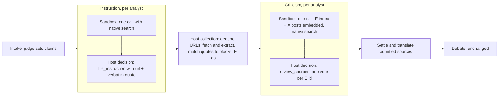

# Native provider research, host-collected evidence and batch source critique

Today each analyst researches through an 8-step loop that our server drives: search, then `read_source` each hit, then file block IDs, with the whole conversation sent again on every step inside a 300-second turn. That loop is slow, costly, and the cause of the "Preparation budget exhausted" failures (AT-185-GA). Once this is done:

- Each analyst researches in **one call** with its provider's own search tools, which run on the provider's side.
- The **host** fetches, extracts and deduplicates the cited URLs, matches the quotes to passages and assigns E ids. The judge's no-op unification turn goes away.
- Each analyst critiques **all E sources in one batch**, with the matched passages in the prompt and the full text of X posts embedded, so analysts without X search can judge them.
- A **local eval** shows whether quotes match, the time budget holds, every source gets a vote and what it costs, before new cases switch.

## What changes

New cases run as **pipeline 3**. Pipeline 2 cases already running keep their phase sessions and tools: changing a seat's system prompt or tools under them would throw "Phase configuration changed". Intake and debate do not change.



### Native research tools, by provider

The tools run on the provider's side within one model call, so the sandbox VM never fetches anything. AI SDK 7 serializes them as `{ type: "provider", id, args }`; the Gateway routes them by model. Production already uses `xai.x_search` through the Gateway (`src/instruction/research.ts`), so that mechanism is proven.

| Seat (default model) | Tools | Status through the Gateway |
| --- | --- | --- |
| Grok (`spacexai/grok-4.7`) | `xai.web_search`, `xai.x_search` | x_search in production use; web_search documented |
| ChatGPT (`openai/...`) | `openai.web_search` | documented by the Gateway |
| Claude (`anthropic/...`) | `anthropic.web_search_20250305`, `anthropic.web_fetch_*` | search documented; fetch inferred, the eval verifies |
| Gemini (`google/...`) | `google.google_search`, `google.url_context` | search documented; url_context inferred, the eval verifies |
| Any other model an admin picks | `gateway.tools.parallelSearch()` | Gateway-executed, any model |

A new `src/instruction/native-research.ts` maps a model id's provider to its tool definitions. They are written as plain provider-tool objects, so the harness needs no new packages and the evidence snapshot needs no rebuild:

```ts
export function nativeResearchTools(modelId: string, phase: "instruction" | "criticism"): ProviderToolDefinition[];
// e.g. for "openai/gpt-6.1-sol":
// [{ type: "provider", id: "openai.web_search", name: "web_search", args: {} }]
```

### The broker accepts these tools, and only these

`validateGatewayGeneration` (`src/instruction/gateway-validation.ts`) rejects every non-function tool today. In pipeline 3 the binding records the exact provider tools of the seat (`gatewayTools`, as today for function tools), and validation accepts a `type: "provider"` entry only when its `id` is allowed for the model's provider and its `args` equal the snapshot. Pipeline 3 bindings also record `maxOutputTokens` (8192 instead of the fixed 4096), because one research report carries every quote. Everything else stays: model, provider options, prompt inspection, and the request budget.

### Network access of the sandbox

**Verified:** native research needs no VM egress. The provider runs the searches; the VM only calls the brokered Gateway path, whose key stays on the host. The real blocker to "research extensively" is the broker rejecting native tools, and the previous section removes it.

Opening the VM to the internet (`"*": []` next to the two forwarded hosts in `instructionSandboxLaunch`, `src/evidence/broker.ts`) is possible with the SDK, but nothing in the harness would use it: the agent has no fetch or shell tool. It would also let a prompt injected by a web page send `task.json` (the case messages, including private submissions) to any host, unaudited. Decided in review: **VM egress stays closed**; `instructionSandboxLaunch` does not change.

### Instruction: one research call, then a structured filing

- **Sandbox call** (`advancePreparation`, `sandbox/harness/instruction-agent.ts`): one `generateText` with the native tools only (no `compute`, no host function tools, so no step ends waiting for us), `stopWhen: stepCountIs(1)`, the call timeout set to the turn's remaining time minus 15 s, and an 8192-token output. The prompt asks for a report that, for each claim, gives sources in favour and against, with the **exact URL** and a **verbatim quote in the source's language**. If the call times out, the turn completes with an empty draft marked as timed out: the analyst then files nothing, and the case goes on instead of failing.
- **Host decision** (`src/court/settled-play.ts`): one generation with a single tool, which replaces `file_evidence` + `finish_instruction` for pipeline 3:

```ts
file_instruction({
  proposals: [{ claimId: "A1", url: "https://…", quote: "verbatim text", stance: "supports", commentary?: "…" }],
  searches: [{ claimId: "A1", supporting: "what was searched and found", opposing: "…" }],
})
```

It records `instruction_completed` and one `evidence_proposed` event per proposal (a new event type). It does not fetch anything: the decision step stays short.

### Host collection replaces the unification turn

After the instruction round, `procedure.ts` calls a new `bench.collect(log)` (alongside `bench.settle`) instead of the judge's `unification` turn. Collection runs in short workflow steps:

1. Group the proposals by `normalizeSourceUrl` and fetch each URL once with `SourceService.read` (durable, deduplicated operations; X posts go through `sourceDownloader`, which reads the whole post via the Grok researcher).
2. Match each quote to blocks with a new `matchQuote(blocks, quote)` in `src/instruction/quote-match.ts`. The normalization is that of `groundResearch` in `evals/tiers/core.ts` (NFKD, no accents, lowercase, punctuation to spaces). The quote must be contained in the concatenated blocks; a quote split by `…` must match segment by segment, in order. It returns the covering `blockIds`, or no match.
3. A matched proposal becomes `evidence_filed` (with `sourceId`, `blockIds`, and the excerpt taken from the blocks, as today). An unmatched or unreachable one is recorded as a `proposal_rejected` audit record, with its reason, and is not evidence.
4. Emit `evidence_unified`, grouped by `sourceId`, exactly as `unify_evidence` does today.

### Criticism: one batch per analyst

The criticism prompt carries the whole index, built by the host from `evidence_unified`:

```text
E3 · "Comunicado oficial…" · x.com · https://x.com/…/status/…
  Claims: A1 supports (grok), A2 context (grok)
  Full post (fetched by the host): «…complete post text…»
E4 · "Informe anual 2025" · indec.gob.ar · https://www.indec.gob.ar/…
  Claims: A1 opposes (claude, gemini)
  Passages: [p2:b4] «…» [p3:b1] «…»   (at most 1,500 characters per source)
```

- **Sandbox call:** one call with the same native tools, asked to check authorship, methodology, traceability and authenticity of every E source, citing E ids.
- **Host decision:** `review_sources`, unchanged (one vote per E id; 3–4 vetoes exclude, a missing vote is not a veto).

The pipeline 2 rule that each research call names a `reviewSourceId` cannot apply to native tools. Instead, all research done during criticism is recorded as `review_context`, so it can never become evidence.

### Audit

The broker already saves each generation's request and response under `instruction/runs/<seat>/<turn>/<call>/`. For pipeline 3 the `model_step` record in `case.jsonl` adds what the provider cited (`data.sources: [{ url, title }]`, and cited text when the provider gives it) and the billable search count. Admitted evidence is still only what the host fetched itself.

## Steps

- [x] 1. Commit the uncommitted preparation timeout fix on its own (`src/instruction/preparation.ts`, harness, test, doc): pipeline 2 keeps using it for running cases and as the rollback path.
- [x] 2. Add pipeline 3: `CaseRecord.pipelineVersion: 1 | 2 | 3`, `requestedPipeline` and `COURT_PIPELINE_VERSION` accept `3`, and a `sharedPipeline(version)` helper replaces the `pipelineVersion !== 2` checks (store, proxy, authorization, routes, archive, workflow). The default stays 2 until step 12.
- [x] 3. `src/instruction/native-research.ts`: the provider → tools table and its tests (Grok, OpenAI, Anthropic, Google and the fallback; the args are stable).
- [x] 4. Broker: pipeline 3 bindings snapshot the provider tools and `maxOutputTokens`, and `validateGatewayGeneration` accepts exactly those. Extend `authorization.test.ts` and `gateway-proxy.test.ts`: an allowed tool passes; an unknown id, changed args, a tool of another provider, or 4096→8192 on a pipeline 2 binding fail.
- [x] 5. Harness: build provider tools from `task.json`, accept `maxOutputTokens`, and write `result.sources` and provider metadata into the result file. `advancePreparation`: in pipeline 3, run one call with no step loop, and complete with an empty, timed-out draft instead of failing.
- [x] 6. `src/instruction/quote-match.ts` and its tests: exact text, accents/case/punctuation differences, `…` segments, a quote spanning blocks, a paraphrase rejected, and a quote matching another source rejected.
- [ ] 7. Instruction for pipeline 3: the research prompt, the `file_instruction` action and schema in `court-tools.ts` / `turns.ts`, and the `evidence_proposed` event in `src/domain/court.ts` (`project` ignores it for the view).
- [ ] 8. Host collection: `collectEvidence` (fetch by unique URL in bounded workflow steps, match, then `evidence_filed`, `proposal_rejected`, `evidence_unified`), wired through `bench.collect` in `procedure.ts` and `court-session.ts`. Pipeline 3 skips the `unification` turn.
- [ ] 9. Criticism for pipeline 3: the E index builder (passage cap, full X post text from the canonical blocks), the batch prompt, native tools, and no `reviewSourceId` host rule. Tests: the index holds every E id, and an X source carries its full text.
- [ ] 10. Audit: add `data.sources` and the search count to pipeline 3 `model_step` records; `case-log` tests.
- [ ] 11. The local eval (see below), then one paid run, with its report committed under `evals/research/results-<date>.md`.
- [ ] 12. Make pipeline 3 the default for new cases once the eval meets its thresholds. Update `docs/shared-instruction.md` (native tools, host collection, batch criticism, network stance) and the mock seat (`createMockSeat`) so that simulated cases run pipeline 3.

## The local eval

`scripts/eval-research.ts` with `evals/research/` (cases, report), following `scripts/eval-tiers.ts`: `--case`, `--out`, `--resume`, `--max-usd` (default 8), refusal of `COURT_AI_MODE=mock`, and no production data. It runs in process, with no sandbox and no database: the same prompt builders, the same native tool table, the harness's call function (exported for this), and a `SourceService` with live download and extraction over `MemoryArtifactStore` and `MemoryOperationRepository`.

Cases: the claims of `evals/tiers/cases.ts` (they have references and expected verdicts), plus AT-185-GA as a text submission that runs from intake (the judge sets the claims first):

```ts
{ id: "at-185-ga", submission: { kind: "text", text: "Flavio Bolsonaro huyó de Brasil y está prófugo" } }
```

For each case, each of the four seats runs gather → decision, then host collection, then critique → votes.

`report.md` gives, per seat and case:

| Metric | Threshold to switch the default |
| --- | --- |
| Gather call latency, against the 285 s call budget | p95 under 240 s, no timeouts |
| Proposals, unique URLs, duplicates removed, fetch failures | reported |
| Quotes matched to blocks | at least 80 % per seat |
| Reference URLs of the case found by at least one seat | reported, a quality signal |
| Votes covering every E id | 100 % per seat |
| X sources: full text embedded, and voted on by the non-Grok seats | 100 % |
| Billable searches and USD cost, by seat | reported, within `--max-usd` |
| Native tool accepted by the Gateway (Anthropic fetch, Gemini url_context) | each one works or is dropped from the table |

## How it is verified

- [ ] `npm test` and `npm run typecheck` pass, with the new tests of steps 3–10.
- [ ] A simulated case (`COURT_AI_MODE=mock`) runs pipeline 3 from intake to debate, without a unification turn, and `case.jsonl` validates.
- [ ] `node --import tsx scripts/test-local-instruction.ts` still passes against the local database (pipeline 2 and 3 selection).
- [ ] `node --import tsx scripts/eval-research.ts --max-usd 8` writes a report that meets the thresholds above.
- [ ] Before the default changes: one staging case in a real sandbox shows a native tool request accepted by the broker, and a forbidden one rejected.

## Decisions

| Decision | Choice | Why |
| --- | --- | --- |
| New pipeline or change pipeline 2 | Pipeline 3 | Running cases would fail on "Phase configuration changed"; pipeline 2 stays as rollback |
| Structured output in the research call | No: a free report, then the host decision files `file_instruction` | Structured output combined with native search is not reliable across providers; the decision channel already exists |
| Where quotes are checked | The host, after all seats, with no feedback to the model | Keeps every model step short; the eval measures the rejection rate before we add a retry loop |
| Quote matching | Normalized exact containment (with `…` segments), no fuzzy score | A model can paraphrase or invent a quote; a score threshold would admit some. Revisit only if the eval misses its threshold |
| Judge unification turn | Removed in pipeline 3 | It takes no input; the host already groups by `sourceId` |
| Host `x_search` for other seats | Dropped in pipeline 3 research | Grok searches X; the critique embeds the full posts for the others |
| Provider tool definitions | Plain objects, no new provider packages | No harness snapshot rebuild; the shapes are pinned by tests and checked by the broker |
| Research call timeout | Count as an empty filing, not a case failure | One slow provider should not fail the case |
| VM egress | Closed (decided in review) | Native tools do not need it; open egress would allow unaudited exfiltration of case material |
| AT-185-GA eval fixture | Its submission text, run from intake | Provided in review; the production case is not reachable locally |

## Risks

- **Gateway support for Anthropic `web_fetch` and Gemini `url_context` is inferred.** The eval tests each one; a tool the Gateway rejects is removed from the table, and the seat keeps search alone.
- **Quote rejection rate.** Models translate or paraphrase quotes. The prompt requires verbatim quotes in the source language, and the eval threshold (80 %) gates the rollout.
- **Gemini grounding may cite redirect URLs.** Collection fetches the final URL and records it, as `SourceService.read` already does; the eval reports fetch failures by domain.
- **One long call per seat.** Agentic search can take minutes. The call runs detached in the VM, so no workflow step holds it, and its timeout counts as an empty filing.
- **Search cost is per call and set by the provider.** The eval reports billable searches and cost before the default changes.

## Out of scope

- Debate, voting and judgment.
- Giving the sandbox agents a fetch or shell tool of their own.
- Moving pipeline 2 cases already running to pipeline 3.
- Retrying a rejected quote with the model (only if the eval shows it is needed).

<details><summary>Evidence behind the main claims</summary>

- Native tools serialize as `{"type":"provider","name":"x_search","id":"xai.x_search","args":{}}` and keep the `ai-language-model-id` header unchanged (an offline check with the installed AI SDK 7; `node_modules/ai/dist/index.js`, `@ai-sdk/gateway`). Documented by Vercel: AI Gateway web search; AI SDK provider pages for xAI, OpenAI, Anthropic and Google.
- Sandbox policy: `NetworkPolicy` accepts `"allow-all"`, `"deny-all"`, or domain rules, and `"*": []` combines with forwarded hosts (`@vercel/sandbox/dist/network-policy.d.ts`; Vercel Sandbox firewall docs). CIDR allow rules would bypass domain rules.
- The broker already stores each generation's request and result (`src/instruction/proxy.ts`, `generation`).
- Acquisition is already deduplicated per case by durable operations and URL aliases (`SourceService.inspect`, `src/instruction/sources.ts`).
- The X post reader already exists (`sourceDownloader`, `src/instruction/research.ts`).

</details>
