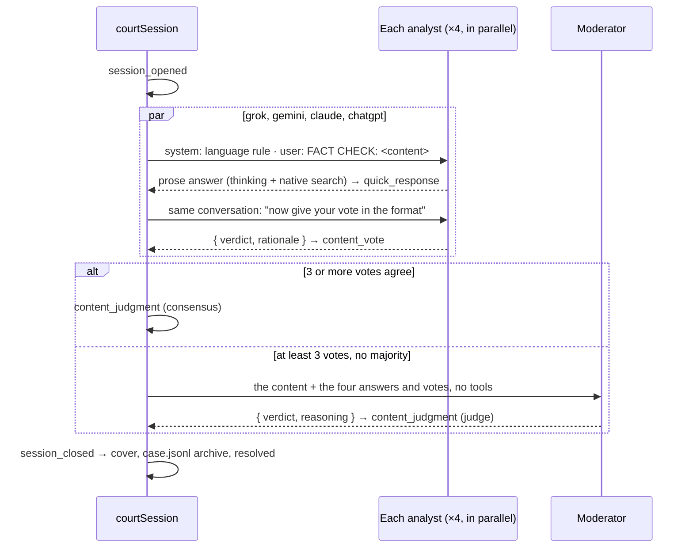

# Add a Quick check type beside the Expert court

Today every case runs the whole court: claims, instruction, source review, debate, objections, votes and summary. That takes many minutes and many paid calls. With this change the request form offers **Rápido** (default) or **Experto**. A Quick check asks each of the four analysts, in parallel, `FACT CHECK: <content>`; each one thinks and searches with its provider's own tools, answers in prose, then gives its overall vote in the usual typed form. A majority decides; otherwise the moderator breaks the tie, reading only those four answers. Expert cases are unchanged.

## What changes

### The check type is part of the submission

`Submission` gets an optional `check` field, chosen on the form and stored with the submission (like `language`). Cases recorded before it have no field and read as Expert, so nothing is migrated, and a rerun keeps the type.

```ts
// src/domain/court.ts
export const CHECK_TYPES = ["quick", "expert"] as const;
export type CheckType = (typeof CHECK_TYPES)[number];

export type Submission = (...) & { language?: CaseLanguageChoice; resolvedLanguage?: string; check?: CheckType };

// Absent on cases recorded before check types existed: they were Expert.
export function checkType(s: Submission): CheckType { return s.check ?? "expert"; }
```

### A Quick session

`courtSession` opens the case, takes the model snapshot and resolves the case language as today, then hands a Quick case to a new `holdQuickSession` instead of `holdSession`. There is no intake, no claims, no evidence, no debate, no objections and no summary.



`holdQuickSession` lives in a new `src/court/quick.ts`. Like `holdSession`, it is pure orchestration over a bench (so it runs inside the workflow and is tested with a scripted bench), and it commits events through the same idempotent `saveEvents`. The four turns run in parallel and are committed together, in `COUNSEL` order, so the numbering of events is deterministic on replay.

### One analyst's turn: a prose answer, then its typed vote

Each turn is the two-step pattern pipeline 3 already uses for its typed decisions (`settled-play.ts`), but called directly from workflow steps, without phase sessions or sandboxes:

1. **Answer** (one workflow step, at most 240 s, the model's configured reasoning effort): `generateText` with the seat's native search tools from `nativeResearchTools(modelId, "instruction")` — xAI web and X search, OpenAI web search, Anthropic search and fetch, Google search and URL context, or Gateway search for another provider. They are passed in-process as provider-executed tools, as `sandbox/harness/instruction-agent.ts` builds them. The answer's text is the analyst's full response; the URLs the provider cited (`nativeCitations`) are kept with it.
2. **Vote** (its own step, reasoning off as in pipeline 3's typed answers): the same conversation plus one request, with `Output.object` over a schema that always asks for a verdict.

```text
system: <languageRule(case language)>
user:   FACT CHECK: Según el INDEC, la pobreza bajó al 31,6 % en el primer semestre de 2026.
        (a link: "FACT CHECK: https://…", the submitter's note on the next line;
         an image: "FACT CHECK:" with the image attached and the note after it)
```

```ts
// src/court/quick.ts
export const quickVoteSchema = z.object({
  verdict: z.enum(VERDICTS).describe(VERDICT_INSTRUCTIONS),
  rationale: z.string().describe("Why, in a few sentences, from your answer above"),
}).strict();

export const QUICK_VOTE_REQUEST =
  "Now give your overall assessment of the submitted content, as you concluded above, in the requested format.";
```

An answer that fails (error or timeout) is tried once more; a vote that does not parse, or has a rationale under 10 characters, is asked again once with the error as feedback. A seat that still has no vote is recorded as `absence` with stage `content`; its answer, if any, stays on the record.

### The moderator's tie-break reads only the answers

When no verdict has three votes and at least three analysts voted, the moderator gets one call with no tools: the language rule, a short brief ("decide only from these answers; do not research"), the content as the analysts saw it, and each analyst's answer and vote. It answers `{ verdict, reasoning }` through `Output.object`, recorded as `content_judgment` with `method: "judge"`. With fewer than three votes there is no result and the case fails with a clear error, which an admin can retry.

### What is recorded

One new court event carries each answer; the vote and result reuse the existing events, so the result card, the share card and the share metadata (`contentOutcome`) work unchanged.

```ts
| { type: "quick_response"; by: Counsel; text: string; sources: Array<{ url: string; title?: string }>; modelId?: string; effort?: string | null }
```

```jsonl
{"schemaVersion":2,"id":"court:2","kind":"court_event","data":{"type":"quick_response","by":"grok","text":"…full answer…","sources":[{"url":"https://www.indec.gob.ar/…"}],"seq":2,…}}
{"schemaVersion":2,"id":"step:quick:grok:answer:0","kind":"model_step","seat":"grok","phase":"quick","modelId":"spacexai/grok-4.7","data":{"channel":"decision","sessionId":"quick:grok","sequence":0,"usage":{…},"request":"quick/grok/answer-0/request.json","result":"quick/grok/answer-0/result.json"}}
{"schemaVersion":2,"id":"court:6","kind":"court_event","data":{"type":"content_vote","by":"grok","verdict":"falso","rationale":"…"}}
```

- Every generation writes `quick/<seat>/<step>/request.json` and `result.json` to the case artifacts and a `model_step` audit record, so `case.jsonl` and the costs in `case.json` include it.
- No `prompt` audit records: they would be machine-translated into the case language, content included; the exact prompt is in each `request.json`.
- Quick cases use the one-file shared archive. `archiveEvidence` skips `loadSettledCorpus` for them, as it already does for a dismissed case.
- `requestedPipeline` gives a Quick case the shared storage version (2, or 3 with `COURT_PIPELINE_VERSION=3`) even under the legacy switch, and checks only Blob storage and the Gateway key, not the sandbox bridge it never uses.

### What the user sees

- **Request form** (`request-form.tsx`, `actions.ts`): a toggle "Tipo de chequeo" with Rápido (selected) and Experto, styled like the material toggle, with a one-line hint for each ("Cada analista responde y vota; sin debate." / "Investigación, crítica de fuentes y debate."). The server validates `check` with `z.enum(CHECK_TYPES).default("quick")`.
- **While it runs** (`session-progress.tsx`): a Quick case shows two stages, "Respuestas" and "Resultado", and "Los analistas están respondiendo.".
- **Result page** (`page.tsx`, `case-result.tsx`, `case-panel.tsx`): the content card shows the verdict and the four votes as today; the header reads "Chequeo rápido" instead of counting claims; the panel card names the check type. The record section is titled "Respuestas de los analistas" and lists each `quick_response` under its speaker, as plain text with line breaks like statements, followed by the cited links, then the votes and the result.
- **Method page and README**: a short section on what a Quick check does and does not do.

## Steps

- [x] 1. Domain: add `CHECK_TYPES`, `CheckType`, `Submission.check`, `checkType()`, the `quick_response` event, `CaseView.responses` in `project()`, and `describe()`/labels in `src/domain/case.ts`.
- [x] 2. Request: the toggle in `request-form.tsx` (default Rápido) and `check` validation in `requestFactCheck` (`actions.ts`); update `request-form.test.ts` and `actions.test.ts`.
- [x] 3. Orchestration: `src/court/quick.ts` with `holdQuickSession(bench)`, `quickPrompt(submission)`, `quickVoteSchema`, `QUICK_VOTE_REQUEST` and the tie-break prompt; `src/court/quick.test.ts` with a scripted bench.
- [x] 4. Live calls: step bodies for the answer, the vote and the tie-break (new `src/court/quick-play.ts`), with in-process native tools, the 240 s bound, artifacts and `model_step` audit records; simulated fixtures in `src/court/mock.ts` so `npm run dev:mock` runs a Quick case.
- [x] 5. Workflow: in `court-session.ts`, branch Quick cases to `holdQuickSession` with `"use step"` wrappers, reuse `determineLanguage` for the case language, skip shared collection and sandbox cleanup; Quick preflight in `rollout.ts` and `steps.ts`.
- [x] 6. Archive: skip the settled corpus for Quick cases in `archiveEvidence`; extend `archive.test.ts`. (Also: the shared branch tells `createEvidenceArchive` it is the one-file format, since a Quick case has no `instruction/base`; `hasEvidenceBase` accepts `case.jsonl` so a missing Quick archive can be rebuilt.)
- [x] 7. UI: `case.tsx` (entry, section, speaker of `quick_response`), `session-progress.tsx`, `page.tsx`, `case-result.tsx`, `case-panel.tsx`, with their tests.
- [x] 8. Docs: README "Court procedure" and the method page.

## How it is verified

- [x] `npm test`, `npm run typecheck` and `npm run build` pass. (`npm test` 456/456 and `typecheck` pass. `npm run build` fails on this Windows machine with the same 53 workflow-bundle errors, `impit`/`node:*` modules, on a clean checkout of `HEAD`: pre-existing, not introduced here; a first version of this change did add errors, fixed by moving `VERDICT_INSTRUCTIONS` to `src/court/verdict-instructions.ts` and the simulated Quick dependencies into `quick-play.ts`.)
- [x] `quick.test.ts`: four agreeing votes give a consensus `content_judgment` without a moderator call; a 2–2 split calls the tie-break, which receives only the content, the answers and the votes; a vote that does not parse is asked again once; a seat that fails twice is an `absence`; fewer than three votes fail the case; no Expert turn kind is ever played.
- [x] Prompt test: a text, a link with a note and an image produce the expected `FACT CHECK:` messages, with the language rule as system prompt.
- [x] `npm run dev:mock`: (checked with a throwaway script running `courtSession` in mock mode on the local database: the Quick case resolved with 4 `quick_response`, 4 `content_vote` and a `content_judgment`, no claims or statements; the Expert case still ran the full court. The form default is covered by `request-form.test.ts`; the browser flow was not clicked through.) a Quick text case resolves with four answers, four votes and a result, and the form defaults to Rápido; an Expert case still runs the full court.
- [ ] (Not run: needs the user's agreement to spend.) One paid live Quick case through `npm run dev` (with the user's agreement): all four answers cite sources, `case.jsonl` holds the four `quick_response` events and their `model_step` records, and the case finishes in a few minutes.

## Decisions

| Decision | Choice | Why |
| --- | --- | --- |
| Where the type lives | `Submission.check`, absent = Expert | Same place as `language`; no migration; reruns keep it |
| Claims in Quick | None: one vote on the whole content | As asked; the result is the content verdict |
| `null` ("no corresponde") vote | Not allowed in Quick | Without claims there is nothing else to judge |
| Research | Each provider's native search tools, in-process | Your answer; no sandbox, so no VM cost or setup |
| Prompt | `FACT CHECK: <content>` plus the case language rule as system prompt | Your answer; replies come in the case language |
| Moderator | Tie-break only, from the content and the four answers; no summary | Your answers |
| Fewer than three votes | The case fails, retryable | Two models are too few for a result; matches the Expert threshold |
| Answer formatting | Plain text with line breaks, as statements | The page renders no Markdown today; a renderer is a separate change |
| Durability | One workflow step per generation, journaled | A completed paid answer is not paid again on replay |

## Risks

- **A long answer with many searches can exceed 240 s.** The attempt is retried once and then recorded as an absence; three absences or more fail the case. The bound can be raised only with the step budget of the hosting plan.
- **Native search cost is not capped per call for every provider** (only Anthropic takes `maxUses`). Each Quick case has at most eight answer calls and eight vote calls, far fewer than an Expert case.
- **Answers may cite pages the host never fetched.** The record shows them as the provider's citations, not admitted evidence; the method page says so.

## Out of scope

- Changing the Expert court, its prompts or pipelines 2 and 3.
- Turning an existing case from one type into the other.
- Markdown rendering of answers, and a moderator summary for Quick cases.
- Restricting Quick to some users: every user who can request a case can choose it.

<details><summary>Why not reuse <code>advanceSharedTurn</code>?</summary>

`advanceSharedTurn` always opens a preparation phase session (a sandbox VM in pipeline 3) before the decision, and its prompts carry the whole court record. A Quick turn has neither, so calling `generateText` from two workflow steps, with the same prose-then-typed pattern and the same artifact and audit records, is smaller and keeps the Expert path untouched.
</details>
